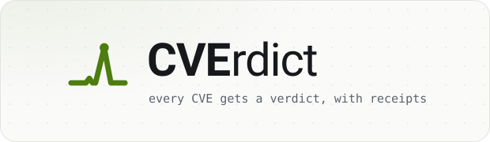
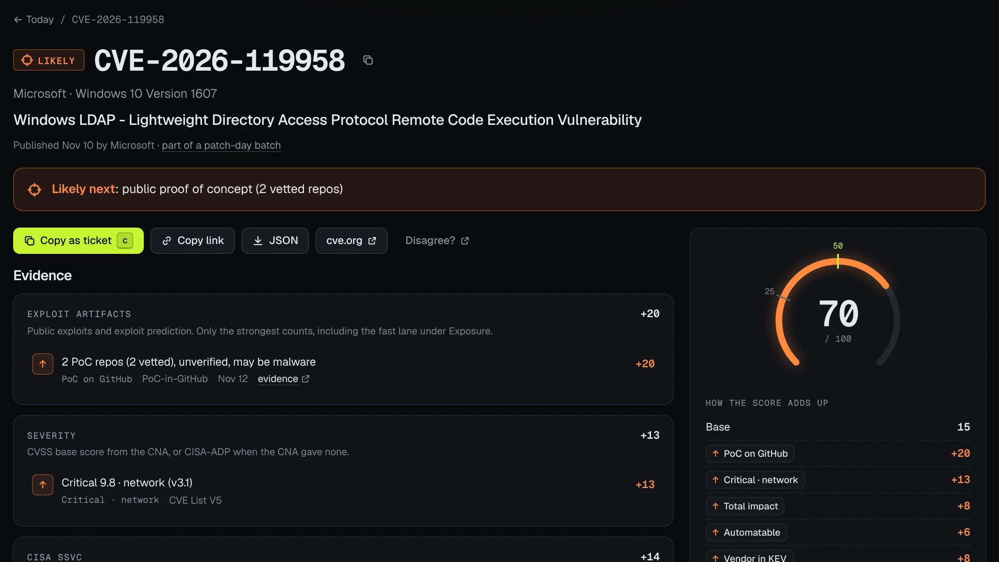
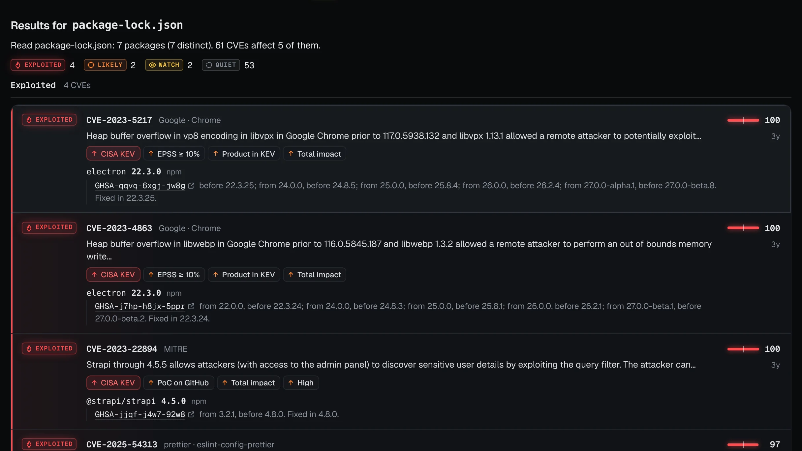
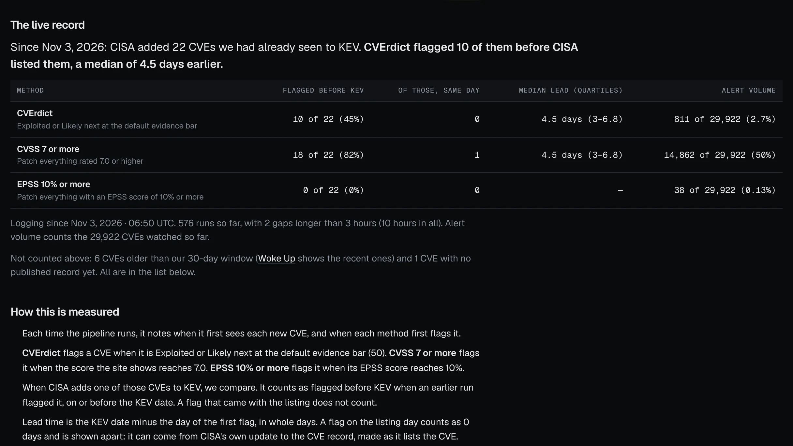
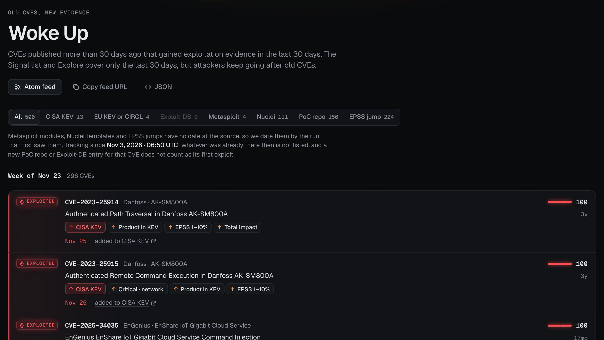
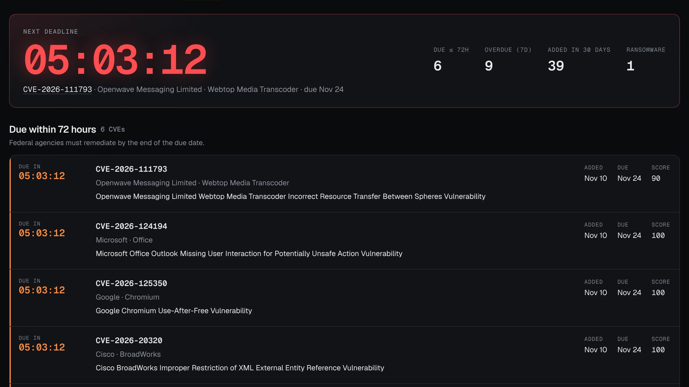
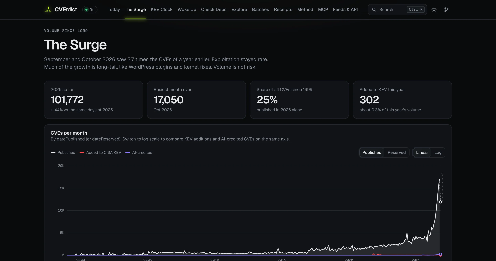

<div align="center">

<picture>
  <source media="(prefers-color-scheme: dark)" srcset="docs/assets/logo-dark.svg">
  
</picture>

**Every CVE gets a verdict. Every verdict comes with receipts.**

Open-source CVE triage for the 2026 flood: the few CVEs that matter today, and exactly why.

<sub>Say it "C-V-E-rdict", like "CVE verdict" run together.</sub>

[](https://github.com/markusweldon/cverdict/actions/workflows/ci.yml)
[](https://github.com/markusweldon/cverdict/actions/workflows/refresh.yml)
[](https://www.npmjs.com/package/cverdict-mcp)
[](LICENSE)
[](#license)

[**Live site**](https://cverdict.dev) · [Use it](#use-it) · [How it works](#how-it-works) · [Scoring](#how-scoring-works) · [Receipts](#receipts) · [MCP](#ask-from-an-ai-agent-mcp) · [Open data API](#open-data-api) · [Deploy your own](#deploy-your-own)

</div>

---

CVErdict is open-source CVE triage for the 2026 flood. Every hour it reads every new CVE record,
joins it with CISA KEV, EPSS and the public exploit feeds, and sorts the last 30 days into four
tiers: **Exploited**, **Likely next**, **Watch** and **Quiet**. Each score is a plain sum of
*reason chips* that you can read and click through to the evidence. There is no machine learning,
no LLM-written text, no NVD dependency and no API key. It is a static site plus an open JSON feed,
rebuilt hourly by GitHub Actions, and a read-only MCP server that reads the same feed, so a fork
gives you your own copy.

<br>

<picture>
  <source media="(max-width: 600px) and (prefers-color-scheme: dark)" srcset="docs/assets/signal-narrow-dark.svg">
  <source media="(max-width: 600px)" srcset="docs/assets/signal-narrow-light.svg">
  <source media="(prefers-color-scheme: dark)" srcset="docs/assets/signal-dark.svg">
  
</picture>

**Thousands in, a few hundred out.** The rest is not hidden: every CVE keeps its score, its tier and its reasons.

<br>


<sub>The Today page with the data of Nov 23, 2026 16:47 UTC, recorded from the production build with
<a href="tools/brand/screens.mjs"><code>tools/brand/screens.mjs</code></a>. The evidence bar re-tiers the page live and the URL remembers it.</sub>

## Use it

| Where | How |
|---|---|
| **In the browser** | Open [cverdict.dev](https://cverdict.dev). No account, no cookies. |
| **From an AI agent** | `claude mcp add cverdict -- npx -y cverdict-mcp` ([other clients](mcp/README.md)) |
| **As JSON** | `curl -s https://raw.githubusercontent.com/markusweldon/cverdict/data/v1/meta.json` ([every file](#open-data-api)) |
| **Your own copy** | Fork it and deploy to Vercel or GitHub Pages ([how](#deploy-your-own)) |

## Why

| Number | What it means |
|--:|:--|
| **102.7k** | CVEs published in 2026 through Nov 23: more than all of 2025 (48.2k) twice over[^ours] |
| **4,302 → 17,050** | CVEs per month, January → October 2026[^ours] |
| **16,337** | new CVEs in the last 30 days. **278** of them (1 in 59) are Exploited or Likely next[^ours] |
| **34** | CVEs added to [CISA KEV](https://www.cisa.gov/known-exploited-vulnerabilities-catalog) in the last 30 days: one KEV addition for every ~480 new CVEs[^ours] |
| **1,094** | Microsoft CVE records on Patch Tuesday, Nov 10. **1** exploited ([CVE-2026-124194](https://www.cve.org/CVERecord?id=CVE-2026-124194)), **6** Likely next[^ours] |
| **Apr 15** | NIST's NVD [stopped enriching most CVEs](https://www.helpnetsecurity.com/2026/04/16/nist-national-vulnerability-database-nvd-enrichment/): only KEV-listed, federal and critical software is still analysed |
| **15 → 274** | CVE records crediting AI tools, October 2025 → October 2026[^ours] |

> “…creating larger haystacks, but it isn't finding more needles.”
>
> Satnam Narang, Tenable, on AI-assisted vulnerability discovery ([iTWire](https://itwire.com/guest-articles/guest-opinion/tenable-patch-tuesday-commentary-september))

The needles are still there. CVErdict shows you the few that matter today, and exactly why.

[^ours]: Our counts from [CVEProject/cvelistV5](https://github.com/CVEProject/cvelistV5), CISA KEV and
    EPSS data, from the run of Nov 23, 2026 16:47 UTC (`meta.json`, `stats.json` and `batches.json`
    on the data branch). CVE totals count records in PUBLISHED state by `datePublished`, as the
    site's charts do.

## How it works

<picture>
  <source media="(prefers-color-scheme: dark)" srcset="docs/assets/how-it-works-dark.svg">
  
</picture>

**One writer, many readers.** The hourly run is the only thing that writes. The site, the feeds, the API and the MCP server all read the same files, so they always agree.

If a source is down, the last good copy is used and marked stale on the site; one failing feed
never stops a run. With no copy at all, that source's evidence is shown as unknown, not as absent.
The run writes the whole tree to a temporary folder, validates every file and only then swaps it
in, so a bad run publishes nothing.

<details>
<summary><b>Where each part lives in the repository</b></summary>

<br>

<picture>
  <source media="(prefers-color-scheme: dark)" srcset="docs/assets/architecture-dark.svg">
  
</picture>

</details>

## How scoring works

<picture>
  <source media="(max-width: 600px) and (prefers-color-scheme: dark)" srcset="docs/assets/scoring-narrow-dark.svg">
  <source media="(max-width: 600px)" srcset="docs/assets/scoring-narrow-light.svg">
  <source media="(prefers-color-scheme: dark)" srcset="docs/assets/scoring-dark.svg">
  
</picture>

**Evidence over severity.** Half of all new CVEs are High or Critical, so CVSS is a small modifier here. What moves a score is evidence that someone can, or does, exploit the bug.

```text
score = 15 + X (exploit artifacts or the fast lane, strongest one) + SEV (CVSS) + SSVC (CISA) + PRIOR (KEV history) + NOISE
```

Any confirmed exploitation adds 75 and floors the score at 90. Within a family only the strongest
chip counts, so three PoCs and a Metasploit module are not four times the evidence. Points are
roughly 20 · log10 of how much each signal raised the odds of a later KEV listing, shrunk for
look-ahead bias: +20 points ≈ 10× the odds. For the first 14 days the feeds have not caught up,
so EPSS is ignored and "no exploit yet" costs 3 points instead of 14. On an internet-facing edge
device (VPN, firewall, gateway and the like, a [curated list](docs/SCORING.md#internet-facing-edge-devices))
it costs nothing, since those are often attacked before any exploit is public. In the same 14
days, a network bug that CISA calls automatable with total impact (or CVSS 9 or more before CISA
has assessed it), on an edge device or in a product already in KEV, gets the
[fast lane](docs/SCORING.md#fast-lane), +12, and is Likely next from day 0: attack tools now build
exploits for such bugs in hours. A feed that could not be loaded counts as unknown, never as "no
exploit".

Every CVE published in the last 30 days, every CVE in KEV (CISA's, or listed as exploited by ENISA
EU KEV or CIRCL) and every older CVE that woke up in the last 30 days gets a score from 0 to 100
and a tier:

| Tier | What it means | What puts a CVE here |
|---|---|---|
| **Exploited** | Patch now. | Confirmed exploitation: CISA KEV, ENISA's EU KEV, CIRCL's catalog, CISA's SSVC assessment says *active*, or the vendor says so |
| **Likely next** | Patch within days. | A Metasploit module or Nuclei template (always at least Likely), or a score at or above the evidence bar |
| **Watch** | Keep an eye on it. | Score from 25 up to the evidence bar |
| **Quiet** | No evidence yet. **Quiet ≠ safe.** | Score below 25 |

The **evidence bar** is the minimum score (out of 100) to flag a CVE as likely exploited next
("Likely next"). It defaults to 50 and the site's dial runs from 35 to 65 (the API and MCP server
accept 30 to 80, parameter `knob`). Lower it to see more, raise it for fewer CVEs with more
evidence behind each; the page re-tiers live and the URL remembers your setting.
[SCORING.md](docs/SCORING.md#tiers-and-the-evidence-bar) explains the range.

Every score is explained by reason chips, each linked to its source. These are the chips of
[CVE-2026-88771](https://www.cve.org/CVERecord?id=CVE-2026-88771), a NetScaler ADC remote code
execution bug, in the run of Nov 23:

```text
CISA KEV · added Sep 27 · due Sep 30
Listed in ENISA EU KEV
Listed by CIRCL (CC0) as exploited · added Sep 28
CISA SSVC: exploitation active · Sep 27
Metasploit: exploit/freebsd/http/citrix_netscaler_cve_2026_88771 (normal)
EPSS 81.9% · 99th pct
12 PoC repos (12 vetted), unverified, may be malware
Critical 9.5 · network (v4.0)
CISA SSVC: total technical impact
CISA SSVC: automatable
Product in KEV (×5): Citrix NetScaler
KEV due Sep 30 · 54 days ago
CISA asks for forensic triage (BOD 26-04)
Internet-facing edge device: Citrix NetScaler ADC and Gateway (load balancer, gateway)
```

Other CVEs carry chips such as `Vendor CVSS: working exploit code exists (E:F)` (+24: weaponized,
not yet exploited), `Fast lane: network, automatable, total impact, product in KEV` (+12 in the
first 14 days), context worth 0 points such as `Part of Microsoft patch day · Nov 10 (1,094)`
or `AI-credited: “Claude Security”` or `Internet-facing edge device: F5 BIG-IP (load balancer, gateway)`, and unknowns
such as `Not settled: 1 PoC repo too new to vet (day 9 of 14)`.

Does it find exploited CVEs before KEV does? Hide the answer key (each CVE's own KEV listing, CISA's
SSVC *active* and any EPSS score from the listing day on) and re-score the 137 recent CVEs CISA
added to KEV from May 24 to Nov 20, 2026: **99 (72%)** still land in Exploited or Likely next,
while CVErdict flagged only **2.3%** of the 76,097 new CVEs of that period. Treat that as an upper
bound, since it counts evidence that has no date. With only evidence dated before each listing it is
59 (43%). From the backtest of Nov 20, 2026 (score model v0.3.0); `npm run backtest` reproduces it.

The full methodology, every chip with its points, the calibration and the known blind spots are in
[docs/SCORING.md](docs/SCORING.md).

## Receipts

<picture>
  <source media="(prefers-color-scheme: dark)" srcset="docs/assets/receipts-dark.svg">
  
</picture>

**In the hindsight backtest, CVErdict catches three quarters of what CVSS 7 catches, with less than a twentieth of the alerts:** 59 of 137 against 80, while flagging 2.3% of new CVEs against 52.5%. The live record is still small: of 18 KEV listings, CVErdict flagged 8 before CISA listed them, against 14 for CVSS 7 (13 earlier and 1 on the listing day itself).

The [Receipts page](https://cverdict.dev/receipts) holds the stricter tests. A live record notes,
to the minute, when each method first flags a CVE and whether that came before CISA listed it; the
page shows how many listings it has judged so far. A backtest, marked as hindsight, uses only
evidence dated before each listing. On the inputs of Nov 20, 2026 (score model v0.3.0), for the
137 recent CVEs CISA added to KEV in the previous 180 days, it gave: CVErdict 59 flagged before the
listing, "CVSS 7 or more" 80, "EPSS 10% or more" 18. CVSS 7 or more catches more, but flags 52.5% of
all new CVEs against CVErdict's 2.3%. The Receipts page always shows the latest run.
`npm run backtest` reproduces it.

## On the site

<picture>
  <source media="(prefers-color-scheme: dark)" srcset="docs/assets/surfaces-dark.svg">
  
</picture>

<table>
<tr>
<td width="50%" valign="top"><a href="https://cverdict.dev/cve/CVE-2026-119958"></a><br><sub><b>CVE page.</b> The verdict, every chip and its points, and the sum.</sub></td>
<td width="50%" valign="top"><a href="https://cverdict.dev/check"></a><br><sub><b>Check Deps.</b> Your SBOM or lockfile, matched in the browser. Nothing is uploaded.</sub></td>
</tr>
<tr>
<td valign="top"><a href="https://cverdict.dev/receipts"></a><br><sub><b>Receipts.</b> Every hit and every miss, against CVSS 7 and EPSS 10%.</sub></td>
<td valign="top"><a href="https://cverdict.dev/woke"></a><br><sub><b>Woke Up.</b> Old CVEs with new exploitation evidence, each with its dated proof.</sub></td>
</tr>
<tr>
<td valign="top"><a href="https://cverdict.dev/kev"></a><br><sub><b>KEV Clock.</b> Federal due dates, counting down.</sub></td>
<td valign="top"><a href="https://cverdict.dev/surge"></a><br><sub><b>The Surge.</b> Monthly volume since 1999, KEV additions and AI credits.</sub></td>
</tr>
</table>

<sub>Screenshots of the production build with the data of Nov 23, 2026 16:47 UTC, dark theme. The site also has a light theme.</sub>

What the card leaves out:

- **Today**: CVEs newly exploited in the last 72 hours pulse on the waterfall, and the legend
  opens a list of them. Click a waterfall column to see that day's CVEs in Explore, or a spike
  label to open its patch-day batch. The feed has filters and a vendor watchlist.
- **CVE pages**: a link shared in Slack, X, LinkedIn, Mastodon, Discord or a messenger shows the
  verdict and score in its preview.
- **Woke Up** watches CVEs that left the window. It counts a CISA KEV, EU KEV or CIRCL listing,
  an EPSS jump or a first public exploit: an Exploit-DB entry, Metasploit module, Nuclei template,
  or a GitHub PoC repo at least 3 days old or with 2 stars (the code is not checked).
- **Check Deps** reads CycloneDX, SPDX, package URL lists and npm, yarn, pnpm, pip, Poetry, uv,
  Pipenv, Go, Cargo, Bundler, Composer, NuGet and Gradle lockfiles. It knows only the tracked CVEs,
  so it is not a full audit.
- **Keys**: `j`/`k`, `/`, `Ctrl K`, `?`.

## Data sources

Only free, public data. Nothing from NVD.

| Source | What we use | Checked | License |
|---|---|---|---|
| [CVE List V5](https://github.com/CVEProject/cvelistV5) | Every CVE record: CNA data, CVSS, exploit maturity, credits | hourly | [CVE Terms of Use](https://www.cve.org/Legal/TermsOfUse) |
| [CISA Vulnrichment](https://github.com/cisagov/vulnrichment) (ADP container in each record) | SSVC decision points; CVSS when the CNA gave none | hourly | CC0-1.0 |
| [CISA KEV](https://www.cisa.gov/known-exploited-vulnerabilities-catalog) | Confirmed exploitation, due dates, ransomware use, vendor history | hourly | CC0-1.0 |
| [ENISA EU KEV](https://euvd.enisa.europa.eu/) (EUVD) | Exploitation reported by ENISA or a national CSIRT of the EU CSIRTs Network, and the date it was listed | every 6 h (published daily) | ENISA material, reproduced with acknowledgement of the source |
| [CIRCL known exploited catalog](https://vulnerability.circl.lu/known-exploited-vulnerabilities-catalog/?catalog_uuid=1a89b78e-f703-45f3-bb86-59eb712668bd) | Exploitation CIRCL (Computer Incident Response Center Luxembourg, the CERT for Luxembourg's private sector) confirms or suspects | every 12 h | CC0-1.0 |
| [SiberKapan honeypot catalog](https://siberkapan.org/kev-catalog) (through CIRCL Vulnerability-Lookup) | Exploitation attempts seen by honeypot and web server sensors in Turkey, shown for information only | every 12 h | CC-BY-4.0 |
| [EPSS](https://www.first.org/epss/) (FIRST) | Probability of exploitation activity in the next 30 days | hourly (published daily) | Free use with attribution |
| [Metasploit Framework](https://github.com/rapid7/metasploit-framework) | Modules that reference a CVE | hourly | BSD-3-Clause |
| [Nuclei templates](https://github.com/projectdiscovery/nuclei-templates) | Templates that reference a CVE, and when the first one for each CVE landed (from the repository's history) | hourly | MIT |
| [Exploit-DB](https://gitlab.com/exploit-database/exploitdb) | Entries that reference a CVE (IDs and links only) | every 6 h | GPL-2.0 |
| [PoC-in-GitHub](https://github.com/nomi-sec/PoC-in-GitHub) | Public proof-of-concept repositories per CVE | hourly | CC0-1.0 |
| [OSV.dev](https://osv.dev/) (GitHub Advisory Database, PyPA, Go, RustSec and Drupal advisories) | Package versions affected by the tracked CVEs, for the Check Deps page only; never part of a score | hourly (full copy weekly) | CC-BY-4.0 (GitHub, PyPA, Go), CC0-1.0 (RustSec), MIT (Drupal) |

What happens when a source is down is under [How it works](#how-it-works). Details and required
notices: [ATTRIBUTIONS.md](ATTRIBUTIONS.md).

## Open data API

Everything the site shows is plain JSON on the `data` branch, refreshed hourly. No key, no rate
limit beyond GitHub's, CC0 for our scores.

```sh
BASE=https://raw.githubusercontent.com/markusweldon/cverdict/data/v1

# Headline numbers for the window
curl -s $BASE/meta.json | jq '{generated_at, published: .counts.window_published, passed: .counts.window_passed}'

# Every CVE exploited in the last 30 days: id, score, vendor, product
curl -s $BASE/signal.json | jq -r '
  .cols as $c | .rows[] | [$c, .] | transpose | map({(.[0]): .[1]}) | add
  | select(.tier == "exploited") | [.id, .s, .v, .p] | @tsv'

# The full reasoning for one CVE (details are sharded by an FNV-1a hash of the ID)
id=CVE-2026-96951
shard=$(node -p 'let h=0x811c9dc5;for(const c of process.argv[1].toUpperCase())h=Math.imul(h^c.charCodeAt(0),0x01000193);((h>>>0)%256).toString(16).padStart(2,"0")' $id)
curl -s $BASE/cve/$shard.json | jq -r --arg id $id '.items[$id].reasons[] | "\(.points)\t\(.label)"'
```

Feeds: [Atom: Exploited + Likely next](https://raw.githubusercontent.com/markusweldon/cverdict/data/feeds/signal.xml) ·
[Atom: KEV additions](https://raw.githubusercontent.com/markusweldon/cverdict/data/feeds/kev.xml) ·
[Atom: old CVEs that woke up](https://raw.githubusercontent.com/markusweldon/cverdict/data/feeds/woke.xml) ·
[iCalendar: KEV due dates](https://raw.githubusercontent.com/markusweldon/cverdict/data/feeds/kev-due.ics)
(also served from the site under `/feeds/`). `woke.json` lists the old CVEs that woke up,
`receipts.json` holds the Receipts figures with every hit and miss, and `packages.json` the package
versions the tracked CVEs affect, which the Check Deps page compares with your file.

Every file, every field, sharding and the versioning policy: [docs/DATA.md](docs/DATA.md).

## Ask from an AI agent (MCP)

CVErdict also runs as a read-only [MCP](https://modelcontextprotocol.io) server, so an AI agent can
ask for verdicts and get the same score, chips and links as the site, with the time of the run and
the files behind every answer. No key, no account. It runs on your machine and reads the `data`
branch on GitHub directly, so it does not depend on the site. It is the npm package
[`cverdict-mcp`](https://www.npmjs.com/package/cverdict-mcp) (Node 22.12 or later):

```sh
claude mcp add cverdict -- npx -y cverdict-mcp      # Claude Code; other clients: mcp/README.md
```

To run a given commit or work on the server, run it from a clone instead:

```sh
git clone --single-branch https://github.com/markusweldon/cverdict.git
cd cverdict && npm ci
claude mcp add cverdict -- npm --prefix "$PWD" run -s mcp
```

Tools: `get_verdict` (1 to 15 CVE IDs), `list_signal`, `kev_due`, `woke_up`, `receipts` and
`search_cves`. Setup for other clients, options and limits: [mcp/README.md](mcp/README.md); what
each answer contains: [docs/DATA.md](docs/DATA.md#mcp-server); copyable commands on the site:
[MCP Server](https://cverdict.dev/mcp).

## Deploy your own

[](https://vercel.com/new/clone?repository-url=https://github.com/markusweldon/cverdict)

**Vercel, zero config.** Import the repository and deploy. The site is static; `/data/*` and
the feed files under `/feeds/` are rewritten to the `data` branch on raw.githubusercontent.com, so
fresh data arrives every hour without a redeploy. One small function answers link-preview bots
only, so shared CVE links show their verdict; people never reach it
([Link previews](docs/DEPLOY.md#link-previews)). A fresh clone reads this repository's data until
you point it at your own: set `repo` in `shared/brand.ts` and change the `/data/` and `/feeds/`
rewrites in `vercel.json` (see [Forking and renaming](docs/DEPLOY.md#forking-and-renaming)). Until
then it needs no workflow runs of its own.

**GitHub Pages.** The repository must be public, because the refresh workflow reads the `data`
branch anonymously.

1. Fork the repository and enable Actions on the fork.
2. Settings → Pages → Source: **GitHub Actions**.
3. Settings → Secrets and variables → Actions → **Variables**: add `REFRESH_SCHEDULE` = `on`.
   Copies skip the hourly schedule without it.
4. Actions → **refresh-data** → Run workflow. From then on it publishes the data and redeploys
   the site every hour.

Pages has no functions, so a shared CVE link shows the site card, not its verdict, and CVE pages
are served with status 404 (they still work in a browser). For links you want to share, use Vercel.

GitHub often runs the hourly schedule late. To refresh every hour, start the workflow from a free
external timer: [Reliable hourly refresh](docs/DEPLOY.md#reliable-hourly-refresh).

Renaming, custom domains, the optional `SITE_URL` variable and troubleshooting: [docs/DEPLOY.md](docs/DEPLOY.md).
Hosting costs nothing on either platform's free tier.

## Local development

Requires Node 22.12+, git and about 1 GB of disk.

```sh
npm ci
npm run mock                   # instant: a deterministic mock dataset in site/public/data
npm run pipeline               # or the real data: the first run clones cvelistV5 (~400 MB), a few minutes
npm run dev                    # http://localhost:5173
```

Both write to `site/public/data/`, which the dev server serves. Useful pipeline flags:
`--offline` (replay the cache), `--now 2026-10-26T19:30:00Z` (freeze time),
`--cvelist-dir` / `--poc-dir` / `--nuclei-dir` (reuse existing clones). `npm run calibrate` takes the same flags
and prints the calibration tables. `npm test` and `npm run typecheck` run the main checks. CI also
builds the site and the MCP server, smoke-tests the server and tests the data-branch publisher (see
`.github/workflows/ci.yml`).
More in [CONTRIBUTING.md](CONTRIBUTING.md).

The README images in `docs/assets/` are generated from code and data: `npm run brand` rebuilds the
logo and the diagrams from the live data branch (or `-- --data <dir>`), `node tools/brand/render.mjs`
renders the social preview PNG and `node tools/brand/screens.mjs` retakes the screenshots and the
demo GIF from a running build. See [tools/brand/README.md](tools/brand/README.md).

## Roadmap

**v1.1**

- **CNA noise panel**: each CNA's volume over the years and how much of it reached KEV (The Surge
  already ranks the CNAs of the last 30 days).
- **EPSS sparklines** on CVE pages and rows.
- **Open Graph images** per CVE. Shared CVE links already carry the verdict, score, KEV and exploit status in
  their preview text, with an image per tier; an image with each CVE's own score may follow.

**v2**

- **Browser extension** that puts the verdict next to any CVE ID on the web.
- **MSRC exploitability index** as a chip for Microsoft CVEs.

## Honest limitations

- **Not in KEV ≠ not exploited.** KEV lists exploitation CISA can confirm, often days or weeks
  late, and it leans toward products US agencies run.
- **Quiet ≠ safe.** Quiet means no public evidence *yet*. Targeted zero-days often leave no
  public artifact until well after the damage.
- **Exposure is yours.** We do not know what you run, where it is reachable or what it protects.
  A Watch CVE on your internet-facing VPN can matter more than an Exploited one in software you
  do not have.
- **The weights are v0 and retrospective.** They were fitted on history with look-ahead bias.
  Treat the score as an ordering, not a probability.
- **Upstream errors flow through.** Descriptions, product names and CVSS vectors are as the CNA
  published them.
- **PoC links are unverified third-party code** and may be malware. Never run one outside a lab.
- **Check Deps is not a scanner.** It knows only the tracked CVEs that an advisory ties to a package
  version, in eight ecosystems. "Affected" means the version is inside the advisory's range, not
  that your code reaches the vulnerable part.

## Contributing

Bug reports, data-source proposals and score disputes are all welcome; each has an
[issue template](https://github.com/markusweldon/cverdict/issues/new/choose). Every CVE page has a
"Disagree?" button that opens a prefilled one. To change the weights, open a pull request with a
calibration diff (`npm run calibrate` before and after): see [CONTRIBUTING.md](CONTRIBUTING.md).
Security issues go through [private reporting](SECURITY.md).

## License

- **Code**: [MIT](LICENSE).
- **Data we create** (scores, tiers, reason chips, batches, stats): [CC0-1.0](https://creativecommons.org/publicdomain/zero/1.0/).
- **Upstream data** stays under its own terms. CVE records are © The MITRE Corporation and used under
  the [CVE Terms of Use](https://www.cve.org/Legal/TermsOfUse); the rest is listed in
  [ATTRIBUTIONS.md](ATTRIBUTIONS.md).

## Acknowledgements

CVErdict stands entirely on public work: the [CVE Program](https://www.cve.org/) and its CNAs;
CISA for [KEV](https://www.cisa.gov/known-exploited-vulnerabilities-catalog) and
[Vulnrichment](https://github.com/cisagov/vulnrichment); ENISA and the EU CSIRTs Network for the
[EU KEV](https://euvd.enisa.europa.eu/); CIRCL for [Vulnerability-Lookup](https://vulnerability.circl.lu/)
and its known exploited catalog; [SiberKapan](https://siberkapan.org/kev-catalog); the [FIRST EPSS SIG](https://www.first.org/epss/)
and Empirical Security; CERT/CC for [SSVC](https://github.com/CERTCC/SSVC); Rapid7 and the
[Metasploit](https://github.com/rapid7/metasploit-framework) community;
[ProjectDiscovery](https://github.com/projectdiscovery/nuclei-templates); OffSec's
[Exploit-DB](https://www.exploit-db.com/); [nomi-sec/PoC-in-GitHub](https://github.com/nomi-sec/PoC-in-GitHub);
[OSV.dev](https://osv.dev/) and the GitHub Advisory Database, PyPA, Go, RustSec and Drupal advisory
databases it collects; and Vercel for the [Geist](https://vercel.com/font) typefaces. None of them endorse this project.
