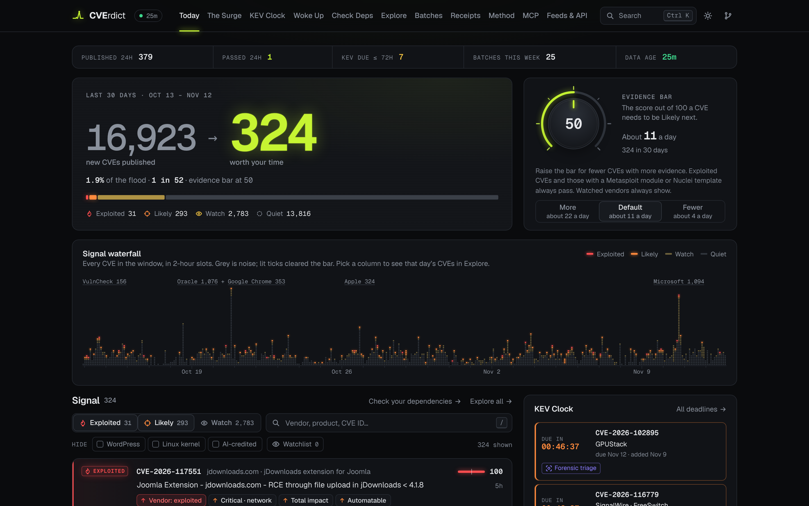
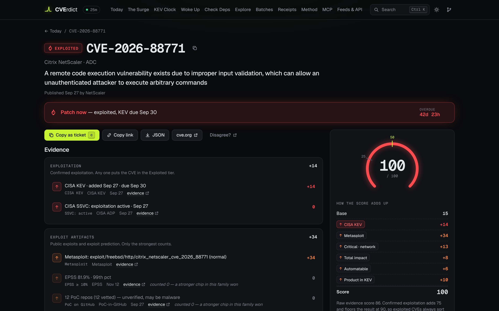
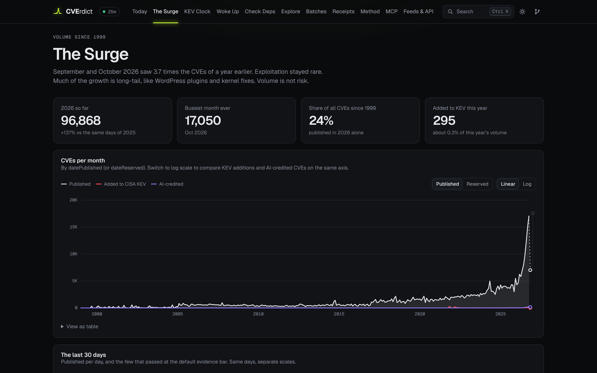

<div align="center">

# CVErdict

### Every CVE gets a verdict. Every verdict comes with receipts.

<sub>Say it "C-V-E-rdict", like "CVE verdict" run together.</sub>

[**Live site**](https://cverdict.dev) · [Receipts](https://cverdict.dev/receipts) · [Methodology](docs/SCORING.md) · [Open data API](docs/DATA.md) · [Deploy your own](#deploy-your-own)

[](https://github.com/markusweldon/cverdict/actions/workflows/ci.yml)
[](https://github.com/markusweldon/cverdict/actions/workflows/refresh.yml)
[](https://www.npmjs.com/package/cverdict-mcp)
[](LICENSE)
[](#license)

</div>







CVErdict is open-source CVE triage for the 2026 flood. Every hour it reads every new CVE record,
joins it with CISA KEV, EPSS and the public exploit feeds, and sorts the last 30 days into four
tiers: **Exploited**, **Likely next**, **Watch** and **Quiet**. Each score is a plain sum of
*reason chips* that you can read and click through to the evidence. There is no machine learning,
no LLM-written text, no NVD dependency and no API key. It is a static site plus an open JSON feed,
rebuilt hourly by GitHub Actions, and a read-only MCP server that reads the same feed, so a fork
gives you your own copy.

## The problem in numbers

| | |
|--:|:--|
| **86.5k** | CVEs published in 2026 through Oct 25: **+80%** on all of 2025[^ours] |
| **4,302 → 14,934** | CVEs per month, January → September 2026[^ours] |
| **15,790** | new CVEs in the last 30 days. **363** of them (1 in 43) are Exploited or Likely next[^ours] |
| **26** | CVEs added to [CISA KEV](https://www.cisa.gov/known-exploited-vulnerabilities-catalog) in October: one KEV addition for every ~540 new CVEs[^ours] |
| **1,407** | Microsoft CVE records on Patch Tuesday, Oct 13. **1** exploited ([CVE-2026-96951](https://www.cve.org/CVERecord?id=CVE-2026-96951)), **3** with a public PoC repo[^ours] |
| **Apr 15** | NIST's NVD [stopped enriching most CVEs](https://www.helpnetsecurity.com/2026/04/16/nist-national-vulnerability-database-nvd-enrichment/): only KEV-listed, federal and critical software is still analysed |
| **23%** | of new CVEs have an EPSS score on the day they are published[^ours] |
| **15 → 212** | CVE records crediting AI tools, October 2025 → October 2026 to date[^ours] |

> “…creating larger haystacks, but it isn't finding more needles.”
> — Satnam Narang, Tenable, on AI-assisted vulnerability discovery ([iTWire](https://itwire.com/guest-articles/guest-opinion/tenable-patch-tuesday-commentary-september))

The needles are still there. CVErdict shows you the few that matter today, and exactly why.

[^ours]: Our counts from [CVEProject/cvelistV5](https://github.com/CVEProject/cvelistV5), CISA KEV and
    EPSS data, from the run of Oct 26, 2026 19:30 UTC (`meta.json` and `stats.json` on the data
    branch). CVE totals count records in PUBLISHED state by `datePublished`, as the site's charts do.

## What it does

Every CVE published in the last 30 days, every CVE in KEV and every older CVE that woke up in the
last 30 days gets a score from 0 to 100 and a tier:

| Tier | What it means | What puts a CVE here |
|---|---|---|
| **Exploited** | Patch now. | Confirmed exploitation: CISA KEV, CISA's SSVC assessment says *active*, or the vendor says so |
| **Likely next** | Patch within days. | A Metasploit module or Nuclei template (always at least Likely), or a score at or above the evidence bar |
| **Watch** | Keep an eye on it. | Score from 25 up to the evidence bar |
| **Quiet** | No evidence yet. **Quiet ≠ safe.** | Score below 25 |

The **evidence bar** is the score out of 100 a CVE needs to be "Likely next". It defaults to 50 and
the site's dial runs from 35 to 65 (the API and MCP server accept 30 to 80, parameter `knob`). Lower
it to see more, raise it for fewer CVEs with more evidence behind each; the page re-tiers live and
the URL remembers your setting. [SCORING.md](docs/SCORING.md#tiers-and-the-evidence-bar) explains the range.

Every score is explained by reason chips, each linked to its source. These are the chips of
[CVE-2026-88771](https://www.cve.org/CVERecord?id=CVE-2026-88771), a NetScaler ADC remote code
execution bug, in the Oct 26 run:

```text
CISA KEV · added Sep 27 · due Sep 30
CISA SSVC: exploitation active · Sep 27
Metasploit: exploit/freebsd/http/citrix_netscaler_cve_2026_88771 (normal)
EPSS 82.2% · 99th pct
12 PoC repos (11 vetted) — unverified, may be malware
Critical 9.5 · network (v4.0)
CISA SSVC: total technical impact
CISA SSVC: automatable
Product in KEV (×5): Citrix NetScaler
```

Other CVEs carry chips such as `Vendor CVSS: working exploit code exists (E:F)` (+24: weaponized,
not yet exploited), context worth 0 points such as `Part of Microsoft patch day · Oct 13 (1,407)`
or `AI-credited: “Claude Security”`, and unknowns such as `Too new: day 13 of 14 — exploit feeds lag`.

On the site:

- **Today**: the noise meter (every CVE of the last 30 days → the few worth your time), a signal
  waterfall of the whole window, each column an hour or more (click a column to see that day's CVEs in Explore, or
  a spike label to open its patch-day batch), the evidence bar, the signal feed with filters and a vendor
  watchlist, patch-day batch cards, the KEV due-date clock, old CVEs that woke up in the last 7 days and
  what changed since the last run.
- **CVE pages**: a one-line verdict, the score arithmetic chip by chip, what we could *not* see,
  an evidence timeline, the facts (CVSS vector, SSVC, EPSS, KEV, affected products) and
  "Copy as ticket". A CVE link shared in Slack, X, LinkedIn, Mastodon, Discord or a messenger
  shows its verdict and score in the preview, with an image for its tier.
- **Woke Up**: CVEs published more than 30 days ago that gained exploitation evidence in the last
  30 days: a CISA KEV listing, an EPSS jump, or their first public exploit of any kind (an
  Exploit-DB entry, Metasploit module, Nuclei template, or a PoC repo on GitHub that is at least
  3 days old or has 2 stars; the code is not checked). The 30-day views cannot see them, yet many
  KEV additions are years old. Each one shows the dated evidence and a link to check it.
- **Receipts**: how often CVErdict flagged a CVE before CISA added it to KEV, next to "CVSS 7 or
  more" and "EPSS 10% or more", with lead times, alert volume and every hit and miss. The live
  record notes each run, to the minute, from the day it started; a backtest of the last 180 days
  is shown apart and marked as hindsight.
- **Check Deps**: drop an SBOM (CycloneDX, SPDX or a list of package URLs) or a lockfile (npm, yarn,
  pnpm, pip, Poetry, uv, Pipenv, Go, Cargo, Bundler, Composer, NuGet or Gradle) and see which of
  the CVEs CVErdict tracks affect your package versions, grouped by verdict, each with the advisory,
  its affected range and the fixed version. The file is read in your browser and never uploaded:
  the page downloads one public file, the same for everyone. It knows only the tracked CVEs, so it
  is not a full audit.
- **KEV Clock**, **Batches**, **Explore** (every window CVE, searchable, filterable by publish
  day), **The Surge** (monthly volume since 1999), **Method**, **Feeds & API** (Atom and iCalendar
  feeds and the JSON files) and **MCP** (how to add the MCP server to an AI agent, and its tools).
- Keyboard first: `j`/`k`, `/`, `⌘K`, `?`. No account, no tracking, no cookies.


## How scoring works

```text
score = 15 + X (exploit artifacts, strongest one) + SEV (CVSS) + SSVC (CISA) + PRIOR (KEV history) + NOISE
```

Any confirmed exploitation adds 75 and floors the score at 90. Within a family only the strongest
chip counts, so three PoCs and a Metasploit module are not four times the evidence. Points are
roughly 20 · log10 of how much each signal raised the odds of a later KEV listing, shrunk for
look-ahead bias: +20 points ≈ 10× the odds. EPSS and "no exploit yet" are ignored for the first
14 days, because the feeds have not caught up, and a feed that could not be loaded counts as
unknown, never as "no exploit".

A real example:

```text
CVE-2026-105016 · Microsoft QUIC Remote Code Execution Vulnerability · day 13

   15  base
  +13  Critical 9.8 · network (v3.1)
   +8  CISA SSVC: total technical impact
   +6  CISA SSVC: automatable
   +8  Vendor in KEV (×390): Microsoft
    0  Too new: day 13 of 14 — exploit feeds lag
  ───
   50  Likely next at the default evidence bar
```

Does it find exploited CVEs before KEV does? Hide the answer key (each CVE's own KEV listing,
CISA's SSVC *active* and its EPSS score) and re-score the 272 CVEs added to KEV in 2026 up to the
run of Oct 26, 2026: **74%** still land in Exploited or Likely next, while only **2.3%** of new CVEs do. Treat that as an upper
bound, since the evidence was collected after the fact. `npm run calibrate` reproduces it.

The [Receipts page](https://cverdict.dev/receipts) holds the stricter tests. A live
record notes when each method first flags a CVE and whether that came before CISA listed it; the
page shows how many listings it has judged so far. A backtest, marked as
hindsight, uses only evidence dated before each listing. In the run of Nov 3, 2026 it gave, for
the 120 recent CVEs CISA added to KEV in the previous 180 days: CVErdict 37 flagged before the
listing, "CVSS 7 or more" 65, "EPSS 10% or more" 17. CVSS 7 or more catches more, but flags 52% of
all new CVEs against CVErdict's 2.6%. `npm run backtest` reproduces it.

The full methodology, every chip with its points, the calibration and the known blind spots are in
[docs/SCORING.md](docs/SCORING.md).

## Data sources

Only free, public data. Nothing from NVD.

| Source | What we use | Checked | License |
|---|---|---|---|
| [CVE List V5](https://github.com/CVEProject/cvelistV5) | Every CVE record: CNA data, CVSS, exploit maturity, credits | hourly | [CVE Terms of Use](https://www.cve.org/Legal/TermsOfUse) |
| [CISA Vulnrichment](https://github.com/cisagov/vulnrichment) (ADP container in each record) | SSVC decision points; CVSS when the CNA gave none | hourly | CC0-1.0 |
| [CISA KEV](https://www.cisa.gov/known-exploited-vulnerabilities-catalog) | Confirmed exploitation, due dates, ransomware use, vendor history | hourly | CC0-1.0 |
| [EPSS](https://www.first.org/epss/) (FIRST) | Probability of exploitation activity in the next 30 days | hourly (published daily) | Free use with attribution |
| [Metasploit Framework](https://github.com/rapid7/metasploit-framework) | Modules that reference a CVE | hourly | BSD-3-Clause |
| [Nuclei templates](https://github.com/projectdiscovery/nuclei-templates) | Templates that reference a CVE | hourly | MIT |
| [Exploit-DB](https://gitlab.com/exploit-database/exploitdb) | Entries that reference a CVE (IDs and links only) | every 6 h | GPL-2.0 |
| [PoC-in-GitHub](https://github.com/nomi-sec/PoC-in-GitHub) | Public proof-of-concept repositories per CVE | hourly | CC0-1.0 |
| [OSV.dev](https://osv.dev/) (GitHub Advisory Database, PyPA, Go, RustSec and Drupal advisories) | Package versions affected by the tracked CVEs, for the Check Deps page only; never part of a score | hourly (full copy weekly) | CC-BY-4.0 (GitHub, PyPA, Go), CC0-1.0 (RustSec), MIT (Drupal) |

If a source is down, the last good copy is used and marked stale on the site; one failing feed
never stops a run. With no copy at all, that source's evidence is shown as unknown, not as absent.
Details and required notices: [ATTRIBUTIONS.md](ATTRIBUTIONS.md).

## Open data API

Everything the site shows is plain JSON on the `data` branch, refreshed hourly. No key, no rate
limit beyond GitHub's, CC0 for our scores.

```sh
BASE=https://raw.githubusercontent.com/markusweldon/cverdict/data/v1

# Headline numbers for the window
curl -s $BASE/meta.json | jq '{generated_at, published: .counts.window_published, passed: .counts.window_passed}'

# Every CVE exploited in the last 30 days: id, score, vendor, product
curl -s $BASE/signal.json | jq -r '
  .cols as $c | .rows[] | [$c, .] | transpose | map({(.[0]): .[1]}) | add
  | select(.tier == "exploited") | [.id, .s, .v, .p] | @tsv'

# The full reasoning for one CVE (details are sharded by an FNV-1a hash of the ID)
id=CVE-2026-96951
shard=$(node -p 'let h=0x811c9dc5;for(const c of process.argv[1].toUpperCase())h=Math.imul(h^c.charCodeAt(0),0x01000193);((h>>>0)%256).toString(16).padStart(2,"0")' $id)
curl -s $BASE/cve/$shard.json | jq -r --arg id $id '.items[$id].reasons[] | "\(.points)\t\(.label)"'
```

Feeds: [Atom: Exploited + Likely next](https://raw.githubusercontent.com/markusweldon/cverdict/data/feeds/signal.xml) ·
[Atom: KEV additions](https://raw.githubusercontent.com/markusweldon/cverdict/data/feeds/kev.xml) ·
[Atom: old CVEs that woke up](https://raw.githubusercontent.com/markusweldon/cverdict/data/feeds/woke.xml) ·
[iCalendar: KEV due dates](https://raw.githubusercontent.com/markusweldon/cverdict/data/feeds/kev-due.ics)
(also served from the site under `/feeds/`). `woke.json` lists the old CVEs that woke up,
`receipts.json` holds the Receipts figures with every hit and miss, and `packages.json` the package
versions the tracked CVEs affect, which the Check Deps page compares with your file.

Every file, every field, sharding and the versioning policy: [docs/DATA.md](docs/DATA.md).

## Ask from an AI agent (MCP)

CVErdict also runs as a read-only [MCP](https://modelcontextprotocol.io) server, so an AI agent can
ask for verdicts and get the same score, chips and links as the site, with the time of the run and
the files behind every answer. No key, no account. It runs on your machine and reads the `data`
branch on GitHub directly, so it does not depend on the site. It is the npm package
[`cverdict-mcp`](https://www.npmjs.com/package/cverdict-mcp) (Node 22.12 or later):

```sh
claude mcp add cverdict -- npx -y cverdict-mcp      # Claude Code; other clients: mcp/README.md
```

To run a given commit or work on the server, run it from a clone instead:

```sh
git clone --single-branch https://github.com/markusweldon/cverdict.git
cd cverdict && npm ci
claude mcp add cverdict -- npm --prefix "$PWD" run -s mcp
```

Tools: `get_verdict` (1 to 15 CVE IDs), `list_signal`, `kev_due`, `woke_up`, `receipts` and
`search_cves`. Setup for other clients, options and limits: [mcp/README.md](mcp/README.md); what
each answer contains: [docs/DATA.md](docs/DATA.md#mcp-server); copyable commands on the site:
[MCP Server](https://cverdict.dev/mcp).

## Deploy your own

[](https://vercel.com/new/clone?repository-url=https://github.com/markusweldon/cverdict)

**Vercel, zero config.** Import the repository and deploy. The site is static; `/data/*` and
the feed files under `/feeds/` are rewritten to the `data` branch on raw.githubusercontent.com, so
fresh data arrives every hour without a redeploy. One small function answers link-preview bots
only, so shared CVE links show their verdict; people never reach it
([Link previews](docs/DEPLOY.md#link-previews)). A fresh clone reads this repository's data until
you point it at your own: set `repo` in `shared/brand.ts` and change the `/data/` and `/feeds/`
rewrites in `vercel.json` (see [Forking and renaming](docs/DEPLOY.md#forking-and-renaming)). Until
then it needs no workflow runs of its own.

**GitHub Pages.** The repository must be public, because the refresh workflow reads the `data`
branch anonymously.

1. Fork the repository and enable Actions on the fork.
2. Settings → Pages → Source: **GitHub Actions**.
3. Settings → Secrets and variables → Actions → **Variables**: add `REFRESH_SCHEDULE` = `on`.
   Copies skip the hourly schedule without it.
4. Actions → **refresh-data** → Run workflow. From then on it publishes the data and redeploys
   the site every hour.

Pages has no functions, so a shared CVE link shows the site card, not its verdict, and CVE pages
are served with status 404 (they still work in a browser). For links you want to share, use Vercel.

GitHub often runs the hourly schedule late. To refresh every hour, start the workflow from a free
external timer: [Reliable hourly refresh](docs/DEPLOY.md#reliable-hourly-refresh).

Renaming, custom domains, the optional `SITE_URL` variable and troubleshooting: [docs/DEPLOY.md](docs/DEPLOY.md).
Hosting costs nothing on either platform's free tier.

## Local development

Requires Node 22.12+, git and about 1 GB of disk.

```sh
npm ci
npm run mock                   # instant: a deterministic mock dataset in site/public/data
npm run pipeline               # or the real data: the first run clones cvelistV5 (~400 MB), a few minutes
npm run dev                    # http://localhost:5173
```

Both write to `site/public/data/`, which the dev server serves. Useful pipeline flags:
`--offline` (replay the cache), `--now 2026-10-26T19:30:00Z` (freeze time),
`--cvelist-dir` / `--poc-dir` (reuse existing clones). `npm run calibrate` takes the same flags
and prints the calibration tables. `npm test` and `npm run typecheck` run the main checks. CI also
builds the site and the MCP server, smoke-tests the server and tests the data-branch publisher (see
`.github/workflows/ci.yml`).
More in [CONTRIBUTING.md](CONTRIBUTING.md).

## Roadmap

**v1.1**

- **CNA noise panel**: each CNA's volume over the years and how much of it reached KEV (The Surge
  already ranks the CNAs of the last 30 days).
- **EPSS sparklines** on CVE pages and rows.
- **Open Graph images** per CVE. Shared CVE links already carry the verdict, score, KEV and exploit status in
  their preview text, with an image per tier; an image with each CVE's own score may follow.

**v2**

- **Browser extension** that puts the verdict next to any CVE ID on the web.
- **MSRC exploitability index** as a chip for Microsoft CVEs.
- **EUVD cross-check** against ENISA's EU Vulnerability Database.

## Honest limitations

- **Not in KEV ≠ not exploited.** KEV lists exploitation CISA can confirm, often days or weeks
  late, and it leans toward products US agencies run.
- **Quiet ≠ safe.** Quiet means no public evidence *yet*. Targeted zero-days often leave no
  public artifact until well after the damage.
- **Exposure is yours.** We do not know what you run, where it is reachable or what it protects.
  A Watch CVE on your internet-facing VPN can matter more than an Exploited one in software you
  do not have.
- **The weights are v0 and retrospective.** They were fitted on history with look-ahead bias.
  Treat the score as an ordering, not a probability.
- **Upstream errors flow through.** Descriptions, product names and CVSS vectors are as the CNA
  published them.
- **PoC links are unverified third-party code** and may be malware. Never run one outside a lab.
- **Check Deps is not a scanner.** It knows only the tracked CVEs that an advisory ties to a package
  version, in eight ecosystems. "Affected" means the version is inside the advisory's range, not
  that your code reaches the vulnerable part.

## Contributing

Bug reports, data-source proposals and score disputes are all welcome; each has an
[issue template](https://github.com/markusweldon/cverdict/issues/new/choose). Every CVE page has a
"Disagree?" button that opens a prefilled one. To change the weights, open a pull request with a
calibration diff (`npm run calibrate` before and after): see [CONTRIBUTING.md](CONTRIBUTING.md).
Security issues go through [private reporting](SECURITY.md).

## License

- **Code**: [MIT](LICENSE).
- **Data we create** (scores, tiers, reason chips, batches, stats): [CC0-1.0](https://creativecommons.org/publicdomain/zero/1.0/).
- **Upstream data** stays under its own terms. CVE records are © The MITRE Corporation and used under
  the [CVE Terms of Use](https://www.cve.org/Legal/TermsOfUse); the rest is listed in
  [ATTRIBUTIONS.md](ATTRIBUTIONS.md).

## Acknowledgements

CVErdict stands entirely on public work: the [CVE Program](https://www.cve.org/) and its CNAs;
CISA for [KEV](https://www.cisa.gov/known-exploited-vulnerabilities-catalog) and
[Vulnrichment](https://github.com/cisagov/vulnrichment); the [FIRST EPSS SIG](https://www.first.org/epss/)
and Empirical Security; CERT/CC for [SSVC](https://github.com/CERTCC/SSVC); Rapid7 and the
[Metasploit](https://github.com/rapid7/metasploit-framework) community;
[ProjectDiscovery](https://github.com/projectdiscovery/nuclei-templates); OffSec's
[Exploit-DB](https://www.exploit-db.com/); [nomi-sec/PoC-in-GitHub](https://github.com/nomi-sec/PoC-in-GitHub);
[OSV.dev](https://osv.dev/) and the GitHub Advisory Database, PyPA, Go, RustSec and Drupal advisory
databases it collects; and Vercel for the [Geist](https://vercel.com/font) typefaces. None of them endorse this project.
